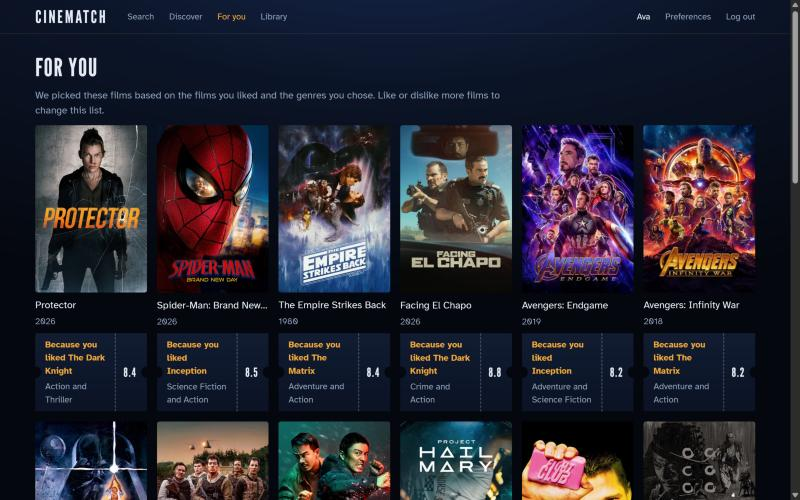
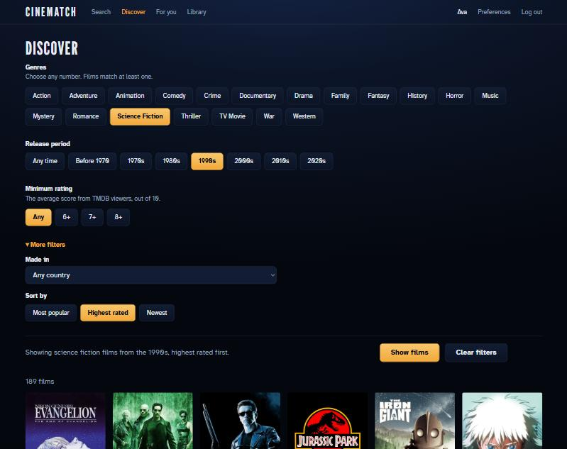
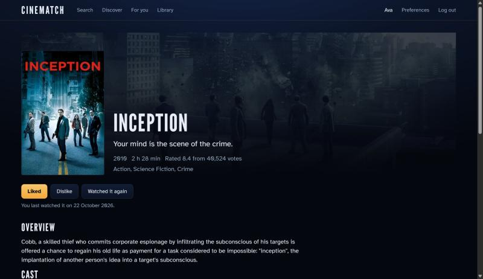
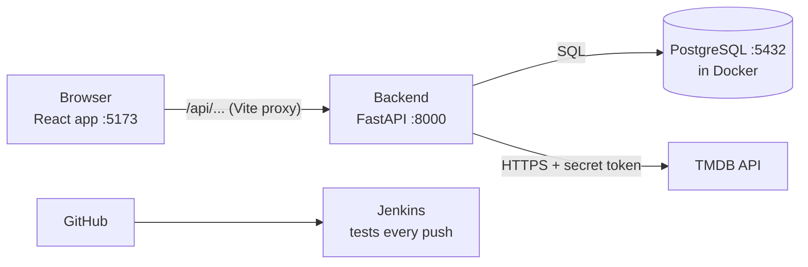

# CineMatch

A web app that suggests films to watch. You make an account or sign in with Google.
Then you pick the genres you like. You search for and look through films. You can
mark films as liked, disliked, or watched. CineMatch then suggests films for you.
Each film comes with a written reason, such as *"Because you liked Inception"*.

A team project by four developers.
Everything runs on your own computer. There is no hosted version.

| | |
|---|---|
| Backend | Python 3.12 · FastAPI · PostgreSQL 16 (in Docker) |
| Frontend | React 18 · Vite · plain JavaScript and CSS |
| Movie data | [TMDB API](https://developer.themoviedb.org/) (free) |
| Sign-in | Email and password · Google (optional) |
| Automation | pytest · ruff · Jenkins pipeline |

**New to the project?** Read this file, then [CONTRIBUTING.md](CONTRIBUTING.md),
then pick a task from [docs/build-plan.md](docs/build-plan.md).

---

## Screenshots

**For you** — film picks made just for you. Each film shows why it was picked, such
as "Because you liked Inception".



**Discover** — narrow down films by genre, release years, lowest rating, and country.
You can also choose how to sort the list.



**Film page** — shows the poster, background image, short summary, rating, and
actors. On this page you can like or dislike a film and mark it as watched.



---

## What it does

| # | Feature |
|---|---|
| 1 | Register and log in with email and password, or with Google; stay logged in after a refresh |
| 2 | Search films by title |
| 3 | Browse and filter by genre, year, popularity, rating and country |
| 4 | Show 10 or 20 results per page |
| 5 | Film detail page: poster, overview, rating, genres, cast |
| 6 | Like or dislike a film; mark it watched; see your watch history |
| 7 | Pick starter genres at sign-up; change them later on the Preferences page |
| 8 | **Personal recommendations, each with a one-sentence reason** |
| 9 | Work offline for a demo, from saved copies of TMDB's answers |
| 10 | Automatic lint, test and build on every push (Jenkins) |

**Not built:** switching the content language (film titles and descriptions) between
English and another language. This was step 52 in the build plan, and we left it out
of this version.

**Out of scope, on purpose:** TV shows, video playback, payments, comments or
sharing, a mobile app, an admin panel, public hosting, e-mail, anything paid.

---

## How it works



Three parts:

1. The **frontend** (React) draws the pages in the browser.
2. The **backend** (Python) answers the frontend's requests.
3. The backend answers from its **own database**, or asks **TMDB** and saves a copy.

**The one rule:** the browser never talks to TMDB. Every TMDB call goes through
the backend, in one file (`backend/app/tmdb.py`). This keeps the API token secret,
lets one cache serve every user, and means a TMDB change touches only one file.

### One request, start to finish

```
1. You type "inception" in the search box.
2. React waits 300 ms after the last key, then calls
       GET /api/movies/search?q=inception&page=1&per_page=10
   with your login token in the Authorization header.
3. Vite forwards /api/* to the backend on port 8000.
4. FastAPI sends the request to search_movies() in app/routers/movies.py.
5. The router calls the service in app/services/movies.py.
6. The service looks in the tmdb_cache table:
     - a saved answer younger than CACHE_HOURS -> use it;
     - otherwise app/tmdb.py asks TMDB and the answer is saved.
7. TMDB always returns 20 films per page. We asked for 10, so we return one half.
8. The backend returns JSON. React draws the poster grid.
```

### How recommendations work

Three small functions in `backend/app/services/recommend.py`:

| Function | What it calculates |
|---|---|
| `weighted_rating` | A fair quality score. A 9.5 from 12 voters counts for less than an 8.4 from 36,000 voters (the IMDb Top 250 formula) |
| `genre_match` | How much of a film is made of genres you like, from 0.0 to 1.0 |
| `score_movie` | `0.7 × taste + 0.3 × quality`. Taste counts more than quality |

Around them, a pipeline:

1. Find your top 3 genres — from films you liked, plus the genres you picked at sign-up.
2. Ask TMDB for well-rated films in those genres (about 60 candidates).
3. Remove films you already watched, rated, or that are under your minimum rating.
4. Score each film. Sort. Keep the top 20.
5. Write a reason for each one: *"Because you liked Inception"*.

A brand-new user has no likes. That is the **cold-start problem**. We solve it by
asking for at least 3 genres at sign-up.

---

## Setup

### What you need installed

| Tool | Version | Check with |
|---|---|---|
| Python | 3.12 or newer | `python --version` |
| Node.js | 20 or newer | `node --version` |
| Docker Desktop | any recent | `docker compose version` |
| Git | any recent | `git --version` |
| A free TMDB account | — | [themoviedb.org/signup](https://www.themoviedb.org/signup) |

### 1. Get the code and make your settings file

```bash
git clone https://github.com/Cinematch-NetAuto/Cinematch.git
cd Cinematch
cp .env.example .env
```

(`cp` works in PowerShell, Git Bash, macOS and Linux. In `cmd.exe` use `copy`.)

Open `.env` and fill in two values:

| Setting | Where to get it |
|---|---|
| `TMDB_API_TOKEN` | TMDB → Settings → API → **API Read Access Token** (the long one, not the short "API Key") |
| `JWT_SECRET` | Run `python -c "import secrets; print(secrets.token_urlsafe(48))"` and paste the output |

Leave every other value as it is. `.env` is gitignored — **never commit it**, and
never paste your token into the group chat. Each developer uses their own token.

**Optional: Google sign-in.** In Google Cloud, make an OAuth client with the type
"Web application". Set `http://localhost` and `http://localhost:5173` as its
Authorized JavaScript origins. Copy its client ID into `.env` as `GOOGLE_CLIENT_ID`.
If you skip this, the Log in page hides the Google button. Everything else still
works the same.

### 2. Start the database

```bash
docker compose up -d db
docker compose ps
```

Wait until the `cinematch-db` row says **healthy**. Your data survives
`docker compose down`.

### 3. Start the backend

```bash
cd backend
python -m venv .venv
.venv\Scripts\Activate.ps1        # Windows PowerShell
# .venv\Scripts\activate.bat      # Windows cmd
# source .venv/bin/activate       # macOS / Linux
pip install -r requirements.txt
python -m scripts.init_db         # creates the tables
python -m scripts.seed_data       # adds genres and demo users
uvicorn app.main:app --reload
```

### 4. Start the frontend (a second terminal)

```bash
cd frontend
npm install
npm run dev
```

### You are set up when all four are true

- [ ] http://localhost:8000/health shows `{"status": "ok"}`
- [ ] http://localhost:8000/docs shows the interactive API page
- [ ] http://localhost:5173 shows the app
- [ ] `pytest -q` in `backend/` passes

### Before a demo without internet

Stay connected to the internet. At most 6 hours before the demo, run this inside the
`backend/` folder:

```bash
python -m scripts.warm_cache
```

This saves the list of genres and the first 5 pages of each Discover sort order. It
also saves a search result for every saved film and every user's recommendations.
When you have no internet, those screens load from the saved copies. Saved answers
stay fresh for 6 hours (`CACHE_HOURS`). After that time, each page without internet
waits about 9 seconds before it loads the saved copy. Film posters come from the TMDB
image server, so without internet you see a placeholder instead. Google sign-in needs
the internet, while email login works without it.

### If something goes wrong

| Symptom | Fix |
|---|---|
| PowerShell: *"running scripts is disabled on this system"* | Run `Set-ExecutionPolicy -Scope CurrentUser RemoteSigned` once, or use `cmd` and `activate.bat` |
| `docker compose up` fails: port 5432 is in use | Another PostgreSQL is running. Stop it, or change the port to `"5433:5432"` in `docker-compose.yml` **and** in `DATABASE_URL` |
| `cinematch-db` never becomes healthy | Run `docker compose logs db` and read the last lines |
| TMDB answers `401` | `TMDB_API_TOKEN` is empty or wrong. Use the Read Access Token, not the API Key |
| `pytest` says *"No module named 'app'"* | Run it from `backend/`, not from the repository root |
| The first request (or each test run) waits about 20 seconds | `DATABASE_URL` says `localhost`. Use `127.0.0.1`: on some Windows PCs `localhost` tries IPv6 first |
| Logging in fails with a 500 error after you pull new code | Your database is older than the code. Run `python -m scripts.init_db` in `backend/` once: it adds the new columns and keeps your data |

---

## Project layout

```
Cinematch/
├── backend/
│   ├── app/
│   │   ├── main.py            creates the app, CORS, /health, includes the routers
│   │   ├── config.py          reads .env — the ONLY file that calls os.getenv
│   │   ├── db.py              database connection and get_db()
│   │   ├── models.py          one SQLAlchemy class per table
│   │   ├── schemas.py         request and response shapes (Pydantic)
│   │   ├── tmdb.py            the ONLY file that talks to TMDB
│   │   ├── security.py        password hashing, login tokens, Google token check
│   │   ├── deps.py            get_current_user() — "you must be logged in"
│   │   ├── routers/           URLs: auth, movies, library, recommend
│   │   └── services/          the real work: movies (search, cache, paging), recommend
│   ├── db/schema.sql          the 8 database tables
│   ├── scripts/               init_db, seed_data, warm_cache (offline demo)
│   ├── tests/                 pytest tests
│   ├── requirements.txt       pinned Python packages
│   └── pyproject.toml         pytest and ruff settings
├── frontend/
│   └── src/
│       ├── api/client.js      apiFetch() — every API call goes through it
│       ├── context/           AuthContext — who is logged in
│       ├── components/        MovieCard, MovieGrid, FilterPanel, GoogleButton, ...
│       ├── pages/             one file per screen (9 screens)
│       └── styles/            tokens.css (all colours) and global.css
├── docs/                      build plan, decisions, glossary, tests, screenshots
├── docker-compose.yml         PostgreSQL, plus Jenkins on request
├── jenkins/Dockerfile         Jenkins with Python, for the pipeline
├── Jenkinsfile                the CI pipeline
└── .env.example               settings template — copy to .env
```

### The three-layer rule (backend)

| Layer | Its job | It must NOT |
|---|---|---|
| Router (`routers/`) | Read the request, call one service function, return the result | Contain logic or SQL |
| Service (`services/`) | Do the work: query the database, call TMDB, calculate | Know about HTTP |
| Model (`models.py`) | Describe a table | Contain logic |

A service takes plain values and returns plain values, so you can test it
without starting a server.

---

## API

Once the backend runs, the live list is at http://localhost:8000/docs.

| Method and path | Login? | File |
|---|---|---|
| `GET /health` | no | `main.py` |
| `POST /api/auth/register` · `POST /api/auth/login` | no | `routers/auth.py` |
| `GET` / `POST /api/auth/google` (Google sign-in) | no | `routers/auth.py` |
| `GET /api/users/me` | yes | `routers/auth.py` |
| `GET /api/genres` | no | `routers/movies.py` |
| `GET /api/movies/search?q=&page=&per_page=` | no | `routers/movies.py` |
| `GET /api/movies/discover?genres=&year_from=&year_to=&sort=&region=&min_rating=&page=&per_page=` | no | `routers/movies.py` |
| `GET /api/movies/{tmdb_id}` | no | `routers/movies.py` |
| `GET` / `PUT /api/me/likes` · `DELETE /api/me/likes?tmdb_id=` · `GET` / `POST /api/me/history` | yes | `routers/library.py` |
| `GET` / `PATCH /api/me/preferences` | yes | `routers/library.py` |
| `GET /api/me/recommendations` | yes | `routers/recommend.py` |

---

## Before every push

```bash
cd backend
pytest -q
ruff check .
```

Both must pass. The Jenkins pipeline runs the same checks, plus `npm run build`
for the frontend.

## Working on the project

Branches, pull requests, file ownership and team rules are in
[CONTRIBUTING.md](CONTRIBUTING.md). In short: branch from `dev`, open a pull
request into `dev`, get one teammate to review it, never push to `main`.

## Documentation

| File | What it holds |
|---|---|
| [CONTRIBUTING.md](CONTRIBUTING.md) | How we work: branches, reviews, code rules |
| [docs/build-plan.md](docs/build-plan.md) | The app as numbered steps: one step = one commit, one phase = one pull request |
| [docs/decisions.md](docs/decisions.md) | Each design decision and the option we rejected |
| [docs/glossary.md](docs/glossary.md) | Every project term, in plain words |
| [docs/manual-tests.md](docs/manual-tests.md) | Click-through test steps |
| [docs/evaluation.md](docs/evaluation.md) | How well the recommender finds films a user liked |
| [docs/design.md](docs/design.md) | The look: colours, type and layout |

## Attribution and licence

This product uses the TMDB API but is not endorsed or certified by TMDB.

Code licensed under the [Apache License 2.0](LICENSE).
